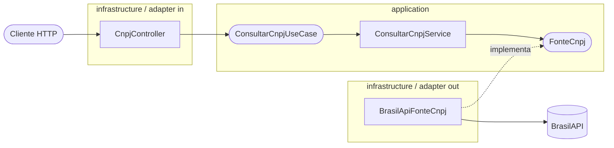
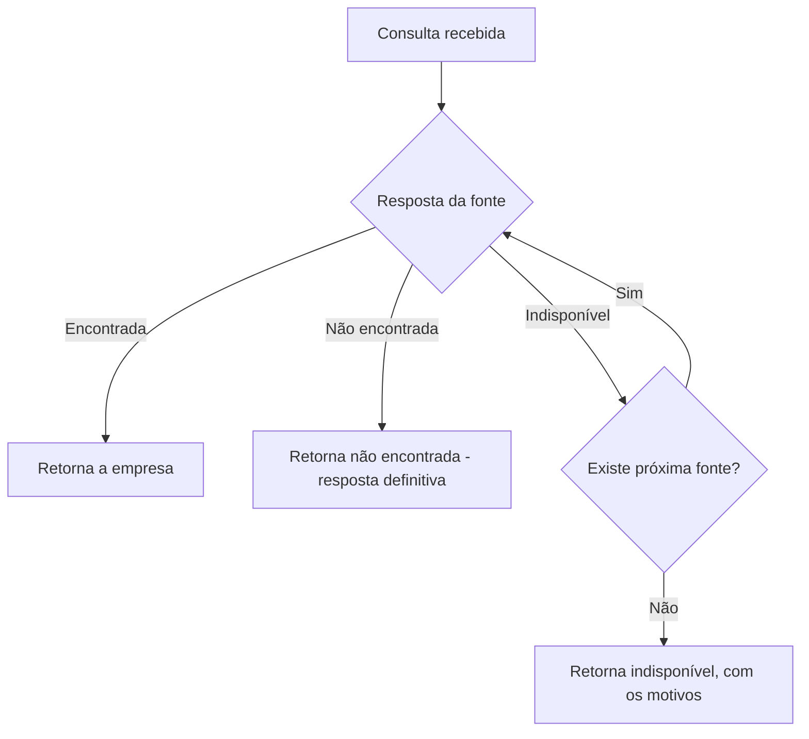

# Consulta CNPJ

**API de consulta e validação de CNPJ, com suporte ao formato alfanumérico.**


O Consulta CNPJ recebe um CNPJ, valida o número (formato numérico tradicional ou alfanumérico) e devolve os dados cadastrais da empresa obtidos em fontes públicas. As fontes são consultadas em ordem de prioridade, com tolerância a falhas e sem expor detalhes internos ao cliente.

---

## Sumário

1. [Visão geral](#1-visão-geral)
2. [Contexto: o CNPJ alfanumérico](#2-contexto-o-cnpj-alfanumérico)
3. [Arquitetura](#3-arquitetura)
4. [Referência da API](#4-referência-da-api)
5. [Validação de CNPJ](#5-validação-de-cnpj)
6. [Primeiros passos](#6-primeiros-passos)
7. [Testes](#7-testes)
8. [Decisões de projeto](#8-decisões-de-projeto)
9. [Segurança e observabilidade](#9-segurança-e-observabilidade)
10. [Limitações conhecidas](#10-limitações-conhecidas)
11. [Roadmap](#11-roadmap)
12. [Contribuindo](#12-contribuindo)
13. [Licença](#13-licença)
14. [Glossário](#14-glossário)

---

## 1. Visão geral

### Funcionalidades

- Validação completa de CNPJ nos formatos **numérico** e **alfanumérico**, incluindo os dois dígitos verificadores.
- Consulta de dados cadastrais: razão social, nome fantasia, situação cadastral, CNAE principal, município e UF.
- Consulta a **múltiplas fontes em ordem de prioridade**, com *fallback* automático quando uma fonte está indisponível.
- Distinção explícita entre **"empresa não existe"** e **"fonte não respondeu"**.
- Limites de tempo configuráveis para conexão e resposta.
- Respostas de erro padronizadas, sem vazamento de detalhes internos.

### Caso de uso típico

Antes de emitir uma nota fiscal, confirmar que o CNPJ do destinatário existe e está ativo. O serviço foi concebido dentro de uma plataforma de automação fiscal, mas é independente e pode ser usado isoladamente.

---

## 2. Contexto: o CNPJ alfanumérico

Desde **31 de julho de 2026**, a Receita Federal emite CNPJs com letras nas 12 primeiras posições. Os CNPJs numéricos já existentes continuam válidos, então os dois formatos coexistem.

Sistemas que assumem "CNPJ = 14 dígitos numéricos" (colunas numéricas, expressões regulares `\d{14}`, conversões para inteiro) deixam de funcionar com o novo formato. Este projeto trata o CNPJ como texto de ponta a ponta e implementa o cálculo dos dígitos verificadores para os dois formatos.

---

## 3. Arquitetura

O projeto segue a **arquitetura hexagonal** (portas e adaptadores): as regras de negócio ficam no centro e dependem apenas de contratos (portas). Detalhes de infraestrutura, como HTTP e acesso a serviços externos, ficam nas bordas e implementam esses contratos.

### 3.1 Visão em camadas



### 3.2 Fluxo de decisão do serviço

O serviço percorre as fontes na ordem configurada e decide a cada resposta:



### 3.3 Modelo de resultados

Uma consulta produz um de três resultados (tipo `sealed` `ResultadoConsulta`):

| Resultado | Significado | Comportamento do serviço |
|---|---|---|
| `Encontrada` | A fonte devolveu os dados da empresa. | Retorna imediatamente. |
| `NaoEncontrada` | A fonte confirma que a empresa não existe. | Retorna imediatamente. A inexistência é uma resposta definitiva, não um erro a contornar. |
| `Indisponivel` | Não foi possível consultar a fonte (falha de rede, timeout, limite de uso, resposta inválida). | Registra o motivo e tenta a próxima fonte. |

Separar "não existe" de "não foi possível consultar" evita declarar inexistente uma empresa real apenas porque uma fonte falhou.

### 3.4 Estrutura de diretórios

```text
src/main/java/br/com/jae/consultacnpj/
├── ConsultaCnpjApplication.java
│
├── domain/                                  Regras e conceitos centrais
│   ├── Cnpj.java                              Value object: normaliza e valida
│   ├── EmpresaCnpj.java                       Dados cadastrais da empresa
│   ├── SituacaoCadastral.java                 Enumeração das situações
│   └── ResultadoConsulta.java                 Encontrada | NaoEncontrada | Indisponivel
│
├── application/                             Casos de uso e contratos
│   ├── port/in/ConsultarCnpjUseCase.java      Porta de entrada
│   ├── port/out/FonteCnpj.java                Porta de saída (fonte de dados)
│   └── service/ConsultarCnpjService.java      Orquestra as fontes
│
└── infrastructure/                          Adaptadores e configuração
    ├── adapter/in/web/
    │   ├── CnpjController.java                Endpoint HTTP
    │   ├── CnpjResponse.java                  Contrato de resposta (200)
    │   ├── ErroResponse.java                  Contrato de erro
    │   └── TratadorDeErros.java               Tratamento global de exceções
    ├── adapter/out/brasilapi/
    │   └── BrasilApiFonteCnpj.java            Integração com a BrasilAPI
    └── config/
        ├── BrasilApiProperties.java           Propriedades de configuração
        └── ConsultaCnpjConfig.java            Montagem dos componentes
```

### 3.5 Regra de dependência

> `domain/` e `application/` **não importam** Spring, bibliotecas HTTP nem JSON. Apenas `infrastructure/` conhece essas tecnologias.

Consequências práticas:

- A lógica de orquestração é testada com fontes falsas, sem rede, em milissegundos.
- Adicionar uma nova fonte de dados é criar uma classe em `adapter/out/`, sem alterar o serviço.
- O contrato HTTP (`CnpjResponse`) é independente do modelo de domínio (`EmpresaCnpj`): mudanças internas não alteram o que os clientes recebem.

---

## 4. Referência da API

### `GET /v1/cnpj/{cnpj}`

Consulta os dados cadastrais de uma empresa.

**Parâmetros de caminho**

| Nome | Tipo | Descrição |
|---|---|---|
| `cnpj` | string | CNPJ numérico ou alfanumérico. Veja [Validação de CNPJ](#5-validação-de-cnpj). |

**Exemplos**

```bash
curl -i http://localhost:8080/v1/cnpj/00000000000191
curl -i http://localhost:8080/v1/cnpj/12ABC34501DE35
```

No PowerShell, use `curl.exe` no lugar de `curl`.

### Resposta de sucesso: `200 OK`

Os valores abaixo são fictícios e servem apenas para ilustrar o formato.

```json
{
  "cnpj": "12ABC34501DE35",
  "razaoSocial": "EMPRESA EXEMPLO LTDA",
  "nomeFantasia": "Exemplo",
  "situacaoCadastral": "ATIVA",
  "cnaeFiscal": "6201500",
  "municipio": "RECIFE",
  "uf": "PE"
}
```

| Campo | Tipo | Descrição |
|---|---|---|
| `cnpj` | string | CNPJ normalizado: 14 caracteres, letras maiúsculas, sem máscara. |
| `razaoSocial` | string | Nome empresarial. |
| `nomeFantasia` | string \| null | Nome comercial, quando informado. |
| `situacaoCadastral` | string | `ATIVA`, `SUSPENSA`, `INAPTA`, `BAIXADA`, `NULA` ou `DESCONHECIDA`. |
| `cnaeFiscal` | string \| null | Código da atividade principal, sempre com 7 dígitos (com zeros à esquerda quando necessário). |
| `municipio` | string \| null | Município. |
| `uf` | string \| null | Unidade da federação. |

### Modelo de erro

Todas as respostas de erro usam o mesmo formato, com um código estável e uma mensagem genérica:

```json
{
  "codigo": "CNPJ_INVALIDO",
  "mensagem": "CNPJ inválido"
}
```

| Status | Código | Condição |
|---|---|---|
| `400` | `CNPJ_INVALIDO` | CNPJ mal formado ou com dígito verificador incorreto. Nenhuma fonte é consultada. |
| `400` | `REQUISICAO_INVALIDA` | Requisição inválida por motivo diferente do CNPJ. |
| `404` | `CNPJ_NAO_ENCONTRADO` | A empresa não existe. |
| `405` | n/a | Método HTTP não suportado. Apenas `GET` é aceito. |
| `500` | `ERRO_INTERNO` | Falha inesperada no serviço. |
| `503` | `FONTE_INDISPONIVEL` | Nenhuma fonte conseguiu responder. A consulta pode ser repetida mais tarde. |

---

## 5. Validação de CNPJ

### Entradas aceitas e rejeitadas

| Entrada | Resultado | Observação |
|---|---|---|
| `00000000000191` | Aceita | Formato numérico. |
| `12ABC34501DE35` | Aceita | Formato alfanumérico. |
| `12abc34501de35` | Aceita | Minúsculas são convertidas para maiúsculas. |
| `12.ABC.34501DE-35` | Aceita | Pontos e hífen são removidos. |
| `12 ABC 345 01DE 35` | Aceita | Espaços comuns (U+0020) são removidos. |
| `12.ABC.345/01DE-35` | Rejeitada no caminho da URL | A barra é separador de caminho. Envie sem a barra. |
| `123` | Rejeitada | Tamanho inválido. |
| `12ABC34501DE36` | Rejeitada | Dígito verificador incorreto. |
| `00000000000000` | Rejeitada | Sequência repetida: satisfaz o cálculo, mas não identifica empresa real. |
| Caracteres fora de ASCII (ex.: `ı`, `ſ`) | Rejeitada | Impede que caracteres visualmente semelhantes sejam aceitos após a conversão para maiúsculas. |
| Outros espaços em branco (tabulação, quebra de linha) | Rejeitada | Apenas `.`, `-`, `/` e o espaço comum são tratados como máscara. |

### Regras do formato alfanumérico

- As **12 primeiras posições** aceitam `0-9` e `A-Z`.
- As **2 últimas posições** são os dígitos verificadores e são sempre numéricas.
- No cálculo, cada caractere vale seu código ASCII menos 48: `0`-`9` valem 0 a 9, `A` vale 17, `B` vale 18, até `Z`, que vale 42.
- Pesos e regra do resto (módulo 11) são os mesmos do CNPJ numérico:
  - DV1: pesos `5 4 3 2 9 8 7 6 5 4 3 2` sobre as 12 primeiras posições.
  - DV2: pesos `6 5 4 3 2 9 8 7 6 5 4 3 2` sobre as 12 primeiras posições mais DV1.
  - `resto = soma % 11`; `DV = resto < 2 ? 0 : 11 - resto`.

Exemplo oficial da Receita Federal: `12.ABC.345/01DE-35`.

---

## 6. Primeiros passos

### Pré-requisitos

- JDK instalado. O build usa o *toolchain* do Gradle para Java **25**.
- Acesso à internet para consultar a BrasilAPI.
- Não é necessário instalar o Gradle: o projeto inclui o *wrapper*.

### Executar a aplicação

```powershell
.\gradlew.bat bootRun
```

Em Linux ou macOS: `./gradlew bootRun`. A API fica disponível em `http://localhost:8080`.

### Gerar o pacote

```powershell
.\gradlew.bat build
```

### Configuração

As propriedades ficam em `src/main/resources/application.yml`:

| Propriedade | Padrão | Descrição |
|---|---|---|
| `consulta-cnpj.brasilapi.base-url` | `https://brasilapi.com.br` | Endereço da fonte. Deve usar `http` ou `https`. |
| `consulta-cnpj.brasilapi.connect-timeout` | `3s` | Tempo máximo para estabelecer a conexão. |
| `consulta-cnpj.brasilapi.request-timeout` | `5s` | Tempo máximo de espera pela resposta. |

Para sobrescrever uma propriedade em tempo de execução:

```powershell
.\gradlew.bat bootRun --args="--consulta-cnpj.brasilapi.request-timeout=10s"
```

> **Falha na inicialização por configuração inválida.** Uma `base-url` sem esquema `http` ou `https` impede a aplicação de iniciar. Erros de configuração aparecem na partida, e não em cada requisição.

---

## 7. Testes

```powershell
.\gradlew.bat test
```

### Estratégia

| Escopo | O que é verificado |
|---|---|
| `Cnpj` | Exemplo oficial da Receita, formatos numérico e alfanumérico, máscara, caixa, tamanhos inválidos, dígito verificador incorreto, sequências repetidas, caracteres especiais e não ASCII. |
| `ConsultarCnpjService` | Ordem das fontes, parada na resposta definitiva, *fallback* em falhas, fonte que lança exceção ou retorna nulo, descarte de empresa de outro CNPJ, agregação dos motivos. |
| `BrasilApiFonteCnpj` | Mapeamento da resposta, códigos de situação, status 404/429/400/500, timeout, servidor indisponível, interrupção de thread, JSON inválido, campos fora do esperado, ausência de vazamento de detalhes nos motivos. |
| Controller e aplicação | Cada status HTTP, ausência de vazamento de detalhes nas respostas, inicialização do contexto e falha na inicialização com configuração inválida. |

Os testes automatizados **não acessam a internet**. A integração HTTP é verificada com um servidor falso do próprio JDK, o que torna a suíte rápida e determinística.

### Verificação manual contra a BrasilAPI

Há um teste desativado por padrão que consulta a BrasilAPI real, para confirmar que o formato da resposta continua compatível com o mapeamento do adaptador:

```powershell
$env:CONSULTA_REAL = "1"
.\gradlew.bat cleanTest test --tests "*ConsultaRealManualTest" -i
Remove-Item Env:CONSULTA_REAL
```

- `-i` exibe a saída no terminal.
- `cleanTest` força a reexecução, evitando que o Gradle reaproveite um resultado anterior.
- Uma resposta `HTTP 429` indica limite de uso da fonte. Aguarde alguns minutos e repita.

---

## 8. Decisões de projeto

| Decisão | Justificativa |
|---|---|
| Três resultados (`Encontrada`, `NaoEncontrada`, `Indisponivel`) em um tipo `sealed` | Distingue inexistência de indisponibilidade. O compilador verifica que todos os casos são tratados nos `switch`. |
| Falha de uma fonte não interrompe a consulta | Exceções, retorno nulo e respostas inválidas de uma fonte são tratados como `Indisponivel`, e a próxima fonte é tentada. |
| Descarte de resposta com CNPJ diferente do solicitado | Protege contra erros de mapeamento em adaptadores. Dado fiscal incorreto é pior que ausência de dado. |
| Dois limites de tempo (conexão e resposta) | Cobrem etapas distintas. Sem o primeiro, uma conexão que não abre bloqueia a thread. Sem o segundo, um servidor que aceita e não responde faz o mesmo. |
| Adaptador nunca propaga erro de rede | Indisponibilidade externa é uma condição esperada e é representada como resultado, não como exceção. |
| Preservação do sinal de interrupção da thread | Ao capturar `InterruptedException`, o adaptador restaura o *flag*, permitindo que o chamador detecte o cancelamento. |
| Contrato HTTP separado do modelo de domínio | Evolução interna do domínio não altera a API pública. |
| Valores duvidosos viram `null` | Um código de atividade inválido na fonte resulta em campo ausente, e não em um valor plausível porém incorreto. |
| `Locale.ROOT` em conversões de texto | Torna o comportamento independente do idioma da máquina (maiúsculas e formatação de dígitos). |
| Rejeição de não ASCII antes da conversão para maiúsculas | Impede que caracteres como `ı` e `ſ` sejam convertidos em `I` e `S` e aceitos indevidamente. |
| Validação do `base-url` no construtor do adaptador | Falha de configuração aparece na inicialização, e não a cada consulta. |
| Sem dependências desnecessárias no build | Testes de integração HTTP usam o servidor embutido do JDK, sem bibliotecas de *mock* adicionais. |

---

## 9. Segurança e observabilidade

### Exposição de informações

- Respostas de erro contêm apenas um código estável e uma mensagem genérica.
- O erro `400` **não repete** o valor recebido.
- Motivos de indisponibilidade (nomes de classes, endereços de fontes, trechos de resposta) **nunca** são enviados ao cliente.
- As páginas de erro padrão do Spring estão configuradas para não incluir mensagem, *stack trace* nem erros de associação (`server.error.include-*: never`).

### Logs

- Indisponibilidade de fontes é registrada em nível `WARN`, com o motivo.
- Falhas inesperadas são registradas em nível `ERROR`, com o *stack trace*.
- Os motivos registrados em log identificam a fonte e o tipo de falha, sem incluir corpos de resposta.

### Autenticação

A API **não possui autenticação nem limite de uso**. Não a exponha diretamente na internet antes de implementar chaves de acesso e limites por consumidor (veja o [roadmap](#11-roadmap)).

---

## 10. Limitações conhecidas

| Limitação | Detalhe |
|---|---|
| Suporte das fontes ao CNPJ alfanumérico não confirmado | O serviço valida e trata o formato novo, mas ainda não foi confirmado se a BrasilAPI reconhece CNPJs alfanuméricos. Se ela responder "não encontrado" para um CNPJ real nesse formato, o serviço repassará a resposta como definitiva. A decisão depende de verificação manual com um CNPJ alfanumérico real. |
| Fonte única | Apenas a BrasilAPI é consultada. Se estiver indisponível ou limitar o uso, a resposta é `503`. O mecanismo de *fallback* já existe; falta uma segunda fonte. |
| Sem cache | Toda consulta chega à fonte. Consultas repetidas consomem o limite de uso da BrasilAPI. |
| Sem autenticação nem limite de uso | Veja [Segurança e observabilidade](#9-segurança-e-observabilidade). |
| Dependência de terceiros | Disponibilidade, latência e atualização dos dados dependem das fontes externas. |
| Barra da máscara no caminho | O CNPJ com barra (`12.ABC.345/01DE-35`) não pode ser enviado no caminho da URL. Use o CNPJ sem a barra. |

---

## 11. Roadmap

| Fase | Entrega | Situação |
|---|---|---|
| 1 | Value object `Cnpj`: validação dos formatos numérico e alfanumérico | Concluída |
| 2 | Modelo de domínio, portas e serviço com *fallback* | Concluída |
| 3 | Adaptador da BrasilAPI | Concluída |
| 4 | Endpoint HTTP `GET /v1/cnpj/{cnpj}` e montagem da aplicação | Concluída |
| 5 | Cache em PostgreSQL e segunda fonte de dados | Planejada |
| 6 | Chaves de acesso, limites por plano e medição de uso | Planejada |

### Pontos de atenção para a fase 5

- Com mais de uma fonte, a **ordem de prioridade deve ser explícita**: a ordem em que o Spring registra componentes não é garantida.
- Definir o tratamento do `404` de uma fonte para CNPJs alfanuméricos que ela possa ainda não reconhecer.
- O cache deve distinguir resposta positiva de resposta negativa, com tempos de expiração diferentes.

### Fase 6

Transforma o serviço em produto: plano gratuito com limite de consultas e plano pago com maior volume e garantias, além da medição de uso por consumidor.

---

## 12. Contribuindo

1. Rode a suíte completa antes de cada commit: `.\gradlew.bat test`.
2. Mantenha a [regra de dependência](#35-regra-de-dependência): `domain/` e `application/` não importam Spring nem bibliotecas de infraestrutura.
3. Novos adaptadores de saída implementam `FonteCnpj` e **não lançam exceção por falhas de rede**; devolvem `Indisponivel`.
4. Testes automatizados não acessam a internet. Use servidores ou fontes falsas.
5. Mensagens de commit seguem o padrão [Conventional Commits](https://www.conventionalcommits.org/pt-br/) (`feat:`, `fix:`, `test:`, `docs:`, `chore:`).

---

## 13. Licença

A definir pelo mantenedor.

---

## 14. Glossário

| Termo | Significado |
|---|---|
| **CNPJ** | Cadastro Nacional da Pessoa Jurídica: número de identificação de empresas no Brasil. |
| **Dígito verificador (DV)** | Os dois últimos caracteres do CNPJ, calculados a partir dos anteriores, usados para detectar erros de digitação. |
| **CNAE** | Classificação Nacional de Atividades Econômicas: código de 7 dígitos que identifica a atividade da empresa. |
| **Situação cadastral** | Estado da empresa perante a Receita Federal (ativa, suspensa, inapta, baixada, nula). |
| **Fonte** | Serviço externo de onde os dados cadastrais são obtidos. |
| **Porta** | Contrato (interface) que define o que a aplicação oferece ou precisa, sem depender de tecnologia. |
| **Adaptador** | Implementação de uma porta para uma tecnologia concreta (HTTP, serviço externo). |
| **Value object** | Objeto definido pelo seu valor, imutável e sempre válido depois de criado (como o `Cnpj`). |
| **Fallback** | Tentativa de uma alternativa quando a primeira opção falha. |
